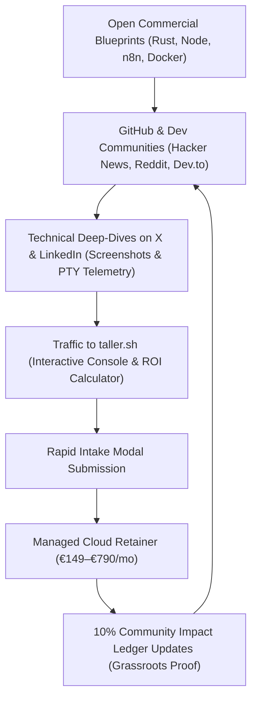

# taller.sh — Marketing & Growth Playbook
**Framework:** `marketing-growth` workflow (`copywriting`, `page-cro`, `seo-audit`, `content-strategy`, `analytics-tracking`, `cold-email`, `emails`, `sales-enablement`)  
**Studio:** taller.sh · Autonomous AI Agents & Custom Intelligence Studio · Barcelona  
**Deployment Target:** European SMBs, Operational Leaders, Scaling Founders  

---

## 1. Executive Positioning & Value Architecture

### Core Value Proposition
> "We engineer, deploy, and manage private autonomous AI agents that eliminate repetitive operational bottlenecks—handling customer intake, document extraction, and continuous system audits 24/7 in dedicated European cloud environments or on your own hardware."

### What We Are NOT
- **Not generic chatbot theater:** No floating generic conversational widgets that require humans to supervise every sentence.
- **Not fragile no-code zap chains:** Engineered with typed contracts, deterministic safety boundaries, and persistent vector databases.
- **Not data-extractive public SaaS:** Every deployment is backed by signed B2B Data Processing Agreements (DPA) and mutual NDAs with zero model training retention.

### Ideal Customer Profile (ICP)
| Attribute | Tier 1 Priority (Primary) | Tier 2 Priority (Secondary) |
|---|---|---|
| **Role** | Operations Director, COO, Managing Partner | Technical Founder, VP Engineering, CTO |
| **Company Size** | 10–100 employees, €1M–€20M ARR | 5–25 employees, fast-growing tech/services |
| **Core Pain** | High-volume WhatsApp/email lead triage, manual PDF/invoice reconciliation, staff burnout on repetitive tasks | Infrastructure maintenance drag, silent database/API regressions, lack of internal AI engineering talent |
| **Buying Trigger** | Hiring for operational admin, missed inbound leads after hours, customer complaints on slow response | High SaaS spend, compliance/GDPR review, data privacy requirements |

---

## 2. Inbound Lead Nurture Cadence (Automated Email Sequence)

Triggered immediately when a visitor submits the Rapid Intake Modal on `taller.sh` (or requests a custom deployment).

### Email 1: Technical Receipt & Initial Scope Review (Minute 0)
- **Goal:** Set technical credibility immediately, establish human peer engineering tone, confirm intake parameters.
- **Trigger:** Form submission on `intake-modal`.
- **From:** `engineering@taller.sh`
- **Subject:** Scope received // taller.sh custom runtime

```text
Hi {{first_name}},

We received your operational scope regarding {{bottleneck}}.

Our engineering team in Barcelona is reviewing your software context:
- Primary bottleneck: {{bottleneck}}
- Software / stack mentioned: {{notes}}
- Designated community project: {{community_jar}}

Unlike traditional software agencies that put you through multi-week sales presentations, we evaluate workflows directly on technical feasibility. 

If this is a clean fit for an autonomous runtime, we will reply within 4 business hours with an initial architecture breakdown and deployment timeline.

If you have urgent questions or want to send additional process documentation, simply reply directly to this thread (hi@arnau.dev) or ping our engineering desk on WhatsApp: https://wa.me/34675758959

Best,
taller.sh Engineering Team
Granollers & Barcelona
```

---

### Email 2: The Architectural Case Study & Hours Recovered (Day 2)
- **Goal:** Overcome skepticism by demonstrating real operational mechanics and quantifiable hours recovered.
- **Subject:** How 18 hours/week were reclaimed on {{bottleneck}}

```text
Hi {{first_name}},

When teams reach out about {{bottleneck}}, their main fear is usually fragile execution: "What happens when an edge case appears?"

Here is how we architected this for an operations team dealing with 40+ daily vendor files:

1. Ingestion & Deterministic Parsing:
The agent listens to incoming document webhooks, verifies SHA-256 idempotency to avoid double-processing, and extracts line items directly into structured JSON.

2. Database Cross-Check:
It compares quantities and totals against existing purchase orders in their database. Discrepancies exceeding 1.5% are isolated immediately.

3. The Fail-Safe Boundary:
If a novel format arrives, the agent does NOT guess. It halts, sends a concise context summary to the operations channel on Slack, and asks for human guidance. Once answered, that solution is permanently recorded into the agent's procedural vector memory.

Result: 18 hours per week of manual data transcription eliminated, with zero hallucinations entering the accounting ledger.

Would an architecture like this fit into your current {{bottleneck}} pipeline?

Best,
taller.sh Engineering Team
```

---

### Email 3: Data Sovereignty & GDPR Compliance (Day 4)
- **Goal:** Eliminate data security and legal objections for enterprise decision-makers.
- **Subject:** Why your operational data never trains external models

```text
Hi {{first_name}},

A question every responsible Operations Director asks before deploying AI into production:

"Where does our company data actually live, and who can see it?"

Most SaaS platforms use click-through terms that permit pooling customer prompts into continuous model fine-tuning. For regulated businesses, that is an unacceptable liability.

With taller.sh, your runtime operates under strict legal and physical boundaries:
- Signed B2B Data Processing Agreement (DPA) and Mutual NDA before any code runs.
- Zero Model Training Retention: All inference calls use dedicated zero-retention enterprise API endpoints.
- European Cloud Isolation: Persistent data resides in encrypted PostgreSQL/SQLite instances hosted exclusively in Frankfurt and Paris data centers.
- Full Portability: If you ever decide to run in-house, we hand over full Docker Compose configurations, database schemas, and skill definitions.

Are there specific compliance or data isolation requirements your team requires?

Best,
taller.sh Engineering Team
```

---

### Email 4: Low-Friction Engineering Consultation & Risk Reversal (Day 7)
- **Goal:** Direct conversion to discovery consultation with 30-day money-back guarantee.
- **Subject:** 30-day operational guarantee // taller.sh

```text
Hi {{first_name}},

We have two remaining engineering build slots open for this month's deployment cohort.

If you want to eliminate {{bottleneck}} this quarter, here is our guarantee:

We deploy and integrate your custom agent within 14 days. If it does not measurably eliminate at least 15 hours of manual work in your first 30 days, we refund 100% of your onboarding fee and monthly subscription. No debates, no friction.

Would 15 minutes this Thursday or Friday work for a quick technical walkthrough of your workflow?

You can reply directly to this email or grab a slot on our calendar:
https://taller.sh/#contact

Best,
taller.sh Engineering Team
```

---

## 3. B2B Outbound Cold Outreach System (Targeting Ops Leaders)

Built following the `cold-email` skill principles: ruthlessly short, peer-to-peer tone, leading with their problem, interest-based CTA.

### Prospecting Filters & Triggers
- **Trigger 1:** Companies hiring for "Customer Support Representative" or "Operations Specialist" (shows manual labor load).
- **Trigger 2:** High-ticket service businesses (logistics, medical clinics, legal consultancies, B2B wholesale) with active WhatsApp/web contact points.
- **Trigger 3:** B2B companies expanding into international European markets (multi-language triage requirement).

### Touch 1: The Operational Friction Observation
- **Subject:** {{company}} intake workflows // quick note

```text
Hi {{first_name}},

Noticed {{company}} is scaling customer intake across multiple channels.

Most operations teams we speak with spend 15 to 25 hours every week manually sorting inbound messages, answering the same five qualifying questions, and copying details into their CRM.

We build private autonomous AI agents that run 24/7 in European cloud environments to handle that entire initial qualification and calendar dispatch, without generic chatbot scripts.

Open to seeing how an operations runtime like this works for a team like {{company}}?

Best,
taller.sh Engineering Team
Barcelona
```

---

### Touch 2: Technical Metric & Blueprint Proof (Day 4)
- **Subject:** Re: {{company}} intake workflows // quick note

```text
Hi {{first_name}},

Following up with a brief metric:

One of our clients recently recovered 70+ monthly staff hours by deploying an autonomous triage agent on their primary intake channel. Lead response time dropped from 4 hours to under 45 seconds, with zero missed weekend inquiries.

We package these as open commercial architecture blueprints (full source code, Docker configs, and SQLite idempotency pipelines) so you never get locked into a vendor platform.

Would this be useful to review with your operations team?

Best,
taller.sh Engineering Team
```

---

### Touch 3: The Clean Breakup & Resource Handoff (Day 9)
- **Subject:** Closing this out // {{company}}

```text
Hi {{first_name}},

Assuming your operational workflows are running smoothly right now.

I'll step back, but if you ever want to audit how much time manual triage or invoice reconciliation is costing {{company}}, feel free to bookmark our production blueprints and ROI calculator: https://taller.sh

All the best with Q4 growth.

Best,
taller.sh Engineering Team
```

---

## 4. Engineering-as-Marketing Distribution Flywheel

Instead of running generic paid ads, taller.sh uses **Engineering-as-Marketing** to attract technical buyers:



### Content Channels & Formats
1. **GitHub Commercial Blueprints:**
   - Offer the blueprint specs for €49 self-hosted licenses.
   - 70% of blueprint buyers convert into managed cloud subscribers once they realize managing production LLM edge cases is better outsourced.
2. **Technical Build Logs on X / LinkedIn:**
   - Share real code snippets: handling SQLite idempotency, PTY shell management in Rust, rate-limit backoffs.
   - Tone: Pragmatic senior systems engineers, zero AI hype, zero buzzwords.
3. **Public Ledger Impact Updates:**
   - Quarterly photographic reports of tools delivered to vocational apprentices and food co-ops in Barcelona.
   - Builds genuine local goodwill and moral authority that generic corporate agencies cannot copy.

---

## 5. Analytics & Conversion Tracking Architecture

Privacy-first tracking setup (compatible with GDPR, Plausible, PostHog, or self-hosted ClickHouse):

### Event Taxonomy
| Event Name | Trigger Location | Parameters | Conversion Significance |
|---|---|---|---|
| `page_view` | All routes | `path`, `referrer` | Baseline traffic volume |
| `roi_slider_change` | `#plans` ROI calculator | `hours_per_week`, `hourly_rate`, `net_savings` | High intent / financial justification |
| `blueprint_inspect_click`| `#blueprints` grid | `blueprint_id` (`agent-deck`, `koi-kds`) | Technical interest signal |
| `intake_modal_open` | All CTA buttons | `source_button`, `order_topic` | Mid-funnel engagement |
| `bottleneck_chip_click` | Intake form modal | `selected_bottleneck` | Lead qualification segment |
| `intake_form_submitted`| Intake form modal | `topic`, `bottleneck`, `contact_channel` | Primary macro conversion |
| `whatsapp_direct_click`| Nav & Contact block | `source_location` | Immediate inbound sales lead |

---

## 6. Objection Handling Field Manual (Sales Enablement)

| Objection | The Underlying Fear | Engineering Response & Proof |
|---|---|---|
| *"Can we trust an AI agent not to hallucinate to clients?"* | Brand damage & misinformation | **Deterministic Guardrails:** The agent is restricted by strict procedural skills. When confidence is below threshold or an unknown edge case appears, it halts and pages human staff via Slack/WhatsApp with complete context. |
| *"Our data is strictly confidential."* | Data breach & public model training | **Signed B2B DPA & Mutual NDA:** Zero-retention enterprise API endpoints only. Encrypted European databases (Frankfurt/Paris) with dedicated tenant isolation. |
| *"We don't have time to configure complex software."* | Onboarding project drag | **Under 60 Minutes Total:** Single scoping interview. taller.sh senior engineers handle 100% of tool integration, testing, and deployment. |
| *"What if we want to cancel or run in-house later?"* | SaaS vendor lock-in | **100% Portability:** Complete export package with Docker Compose, SQLite databases, and skill runbooks to self-host forever. |
